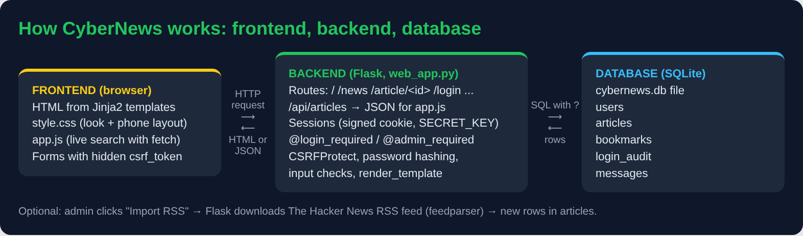
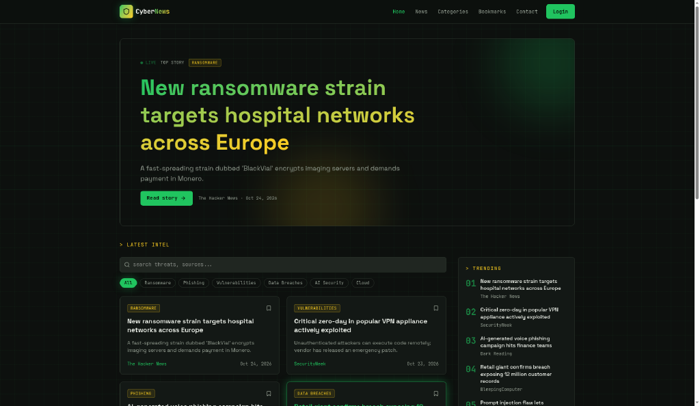
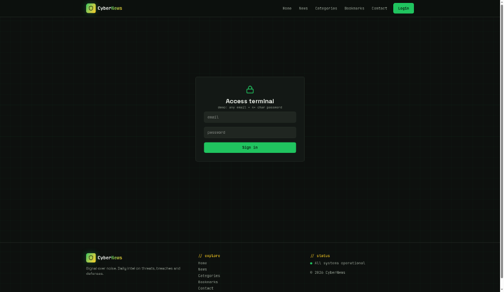
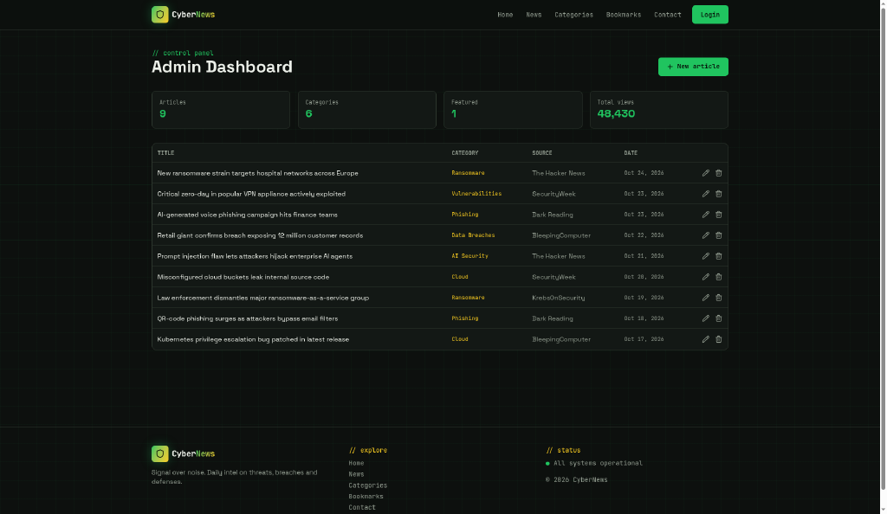

# CyberNews – Project Summary

**Individual project · Module 1 · Built with Flask, SQLite, Jinja2, CSS and JavaScript**

## What my website does

CyberNews is a website that puts cybersecurity news in one place. When you open it you see a dashboard
with three featured stories, a grid of article cards, and a list of categories. You can search and filter
the news by category, source and date, and the results change straight away without the page reloading.
You can click any card to read the full article page.

If you make an account, you can bookmark articles and find them again on "My bookmarks".
If you are the admin, you also get an admin dashboard where you can add, edit and delete articles,
import real headlines from The Hacker News RSS feed, read contact messages, and look at a login audit log.

To be honest about the content: the 12 articles that come with the project are **sample stories I wrote
myself** with made-up companies (Contoso, Northwind, Fabrikam). They have a yellow "Sample" badge, and the
source links only go to the news sites' home pages. The real headlines come in with the RSS import button.

## Main features

- Page structure with header, navigation, main content and footer (one shared `base.html` layout)
- News dashboard with featured stories and article cards
- Categories, live search, and filters by source, date and category
- Individual article pages
- Dynamic content: JavaScript `fetch()` loads JSON from my Flask API (`/api/articles`)
- Flask backend with about 20 routes
- SQLite database with 5 tables: users, articles, bookmarks, login_audit, messages
- Forms: register, login, add/edit article, contact
- Login, logout and sessions
- Two roles: **user** and **admin**, checked with my own `@admin_required` decorator
- Bookmarks, login audit log, RSS import, contact messages
- Works on phones (tested at 390 px wide)
- 19 automatic tests with pytest, plus a curl security check script

## Technologies

| Part | What I used |
|---|---|
| Backend | Python 3, Flask 3 |
| Templates | Jinja2 (comes with Flask) |
| Database | SQLite with Python's built-in `sqlite3` module |
| Security | Werkzeug password hashing, Flask-WTF CSRF protection |
| Frontend | HTML, CSS (grid + flexbox + media queries), plain JavaScript (`fetch`) |
| Extra | feedparser for The Hacker News RSS feed |
| Testing | pytest, curl, headless Chrome for screenshots |
| Version control | git |

## Architecture



```
   FRONTEND (browser)            BACKEND (Flask)                 DATABASE (SQLite)
 ┌──────────────────────┐     ┌──────────────────────────┐     ┌──────────────────┐
 │ HTML from templates  │ --> │ routes in web_app.py     │ --> │ cybernews.db     │
 │ style.css            │ HTTP│ sessions + roles         │ SQL │  users           │
 │ app.js  (fetch)      │ <-- │ CSRF, hashing, checks    │ <-- │  articles        │
 │ forms + csrf_token   │HTML/│ /api/articles -> JSON    │rows │  bookmarks       │
 └──────────────────────┘JSON └──────────────────────────┘     │  login_audit     │
                                                               │  messages        │
                                                               └──────────────────┘
```

In simple words: the **browser** asks for a page. **Flask** finds the right route, checks who you are
(session) and what you are allowed to do (role), asks the **database** for the data with a safe SQL query,
and puts the data into a **template**. The browser gets HTML back. For live search, `app.js` asks for JSON
instead of HTML and builds the cards itself.

## Security measures

- **Passwords are hashed** with `generate_password_hash`. Even I can't read them in the database.
- **SQL injection:** every query uses `?` placeholders. Typing `' OR 1=1 --` in the search just finds 0 articles.
- **XSS:** Jinja2 autoescapes everything, my JavaScript uses `textContent` instead of `innerHTML`,
  and article links must start with `http://` or `https://` (so no `javascript:` links).
- **CSRF:** Flask-WTF puts a secret token in every form. A POST without it gets 400.
- **Roles:** normal users get **403 Forbidden** on every admin page, even if they type the address.
- **Secret key** comes from the `SECRET_KEY` environment variable, not from the code.
- **Session safety:** cookie is HttpOnly and SameSite=Lax, and the session is cleared on login.
- **Login audit log** records successful logins, failed logins, logouts and new accounts.
- Same error for "wrong username" and "wrong password", so nobody can find out which usernames exist.
- Debug mode is off unless I switch it on, so the debugger can't be used by others.

## My AI prototype vs. my Flask website

Before building anything, I asked an AI website builder, **Lovable**, to make a CyberNews website.
It called it **"CyberNews Pulse"**. It asked me no questions and made the whole thing in a few minutes.

- Lovable project: https://lovable.dev/projects/dc6b9d38-b39a-40b0-9679-c08d98ac2cef
- Preview: https://dc6b9d38-b39a-40b0-9679-c08d98ac2cef.lovableproject.com/
- My 8 screenshots of it: `ai_prototype/` folder



### What the AI did better

- **Looks.** Honestly, it looks more professional than mine: a dark charcoal background with a grid and a
  soft glow, headlines that fade from green to yellow, neon green (#22c55e) and yellow (#facc15), and small
  monospace tags. Funny thing: those are the same two colours I already used in my own style.css.
- **Speed.** A full-looking site in minutes: header and nav, a big featured "top story", 9 article cards,
  category chips and a search that really filter the cards, a "Trending" sidebar, an article page, a login
  page called "Access terminal", an admin dashboard with stat cards and an edit/delete table, and a contact form.
- **Ideas I can borrow.** The trending sidebar, category chips instead of a drop-down, and the bookmark icon on each card.

### What my Flask website does that the prototype doesn't

| Feature | AI prototype (Lovable) | My CyberNews (Flask) |
|---|---|---|
| Where data lives | Only in the browser, gone for other users | SQLite database on the server |
| Login | Did not work in the preview | Real login with sessions |
| Passwords | Ended up in the address bar | Hashed with Werkzeug, never stored or shown |
| Admin page | Anyone can open `/admin` | `@admin_required` → normal users get **403** |
| Add / edit / delete | Buttons are there (I did not test them) | Working, admin only, checked on the server |
| CSRF protection | None that I could see | Token in every form, missing token → 400 |
| Bookmarks | Only saved in this browser | Saved per user in the database |
| Contact form | Sends nothing | Saved in the database, shown to the admin |
| Audit log | No | Every login, failed login and logout |
| Sample articles | Look like real news, not labelled | Marked "Sample", links only to home pages |
| Tests | None | 19 pytest tests + curl security checks |

### The security lessons I learned from it



1. **Password in the URL.** When I pressed Sign in on the prototype's login page, the page reloaded and my
   email **and password** appeared in the address bar (`?email=...&password=...`). This usually happens when a form has
   no `method="POST"` and nothing handles it, so the browser sends it as GET. A URL is saved in the browser
   history, in server logs and in proxy logs, and can be seen over someone's shoulder. That's why all my
   login and register forms use `method="POST"`.
2. **Unguarded admin page.** I could open the prototype's `/admin` without logging in at all (the nav still
   says "Login" in my screenshot). Hiding a button is not security. My site checks the role **on the server** for
   every admin route.
3. **Pretty is not the same as safe.** The prototype looks finished, but it has no backend, so nothing a user
   does is really saved or checked. If I only looked at the screenshots, I could think it was a real product.



**My conclusion:** the AI is great for a quick picture of the goal and for design ideas. But I could not
explain or trust its security, and the important parts were missing. Building it myself in Flask was
slower, but now everything works on a real server, and I can explain and test every line.

## What challenged me

- **Sessions and roles.** Hiding the Admin link from normal users is easy, but I learned that hiding a link
  is not security, because anyone can type `/admin` in the address bar. The real check has to be on the
  server, so I wrote the `@admin_required` decorator and tested it with a normal account.
- **CSRF tokens.** With CSRFProtect switched on, every POST form needs the hidden token, including small
  ones like Log out, Bookmark and Delete. I also had to switch CSRF on in the right order, so the
  "security check failed" page still shows who is logged in.
- **Jinja macros.** My filter drop-downs were empty because imported macros don't see template variables
  by default. I fixed it with `import ... with context`, and I added a test so it can't break again.
- **JavaScript and safety together.** Building cards with `innerHTML` would have been shorter, but it would
  have let a bad title run as code. I used `textContent` instead.

## What I'm proud of

- The live search: you type and the cards change instantly, and it still works without JavaScript.
- The security tests: I tried SQL injection, XSS, missing CSRF tokens and a normal user on admin pages
  on my own app, and every attack failed the way it should.
- The audit log, because it shows a failed login in red, like a small version of what a SOC analyst looks at.
- Keeping it honest: sample content is clearly labelled, and real news only comes from the RSS feed.

## Next steps

- Rate limiting / lock the account after many failed logins
- Password reset and changing your own password
- Comments or reactions on articles
- Pagination when there are many articles
- Deploy online with HTTPS (for example with gunicorn behind a web server)
- Automatic RSS import every hour instead of a button

## Links

- Project repository: [github.com/sonieja/cybernews](https://github.com/sonieja/cybernews)
- AI prototype (Lovable "CyberNews Pulse"): https://lovable.dev/projects/dc6b9d38-b39a-40b0-9679-c08d98ac2cef
- AI prototype preview: https://dc6b9d38-b39a-40b0-9679-c08d98ac2cef.lovableproject.com/
- AI prototype screenshots: `ai_prototype/` folder (8 pictures)
- Final website screenshots: `screenshots/` folder
